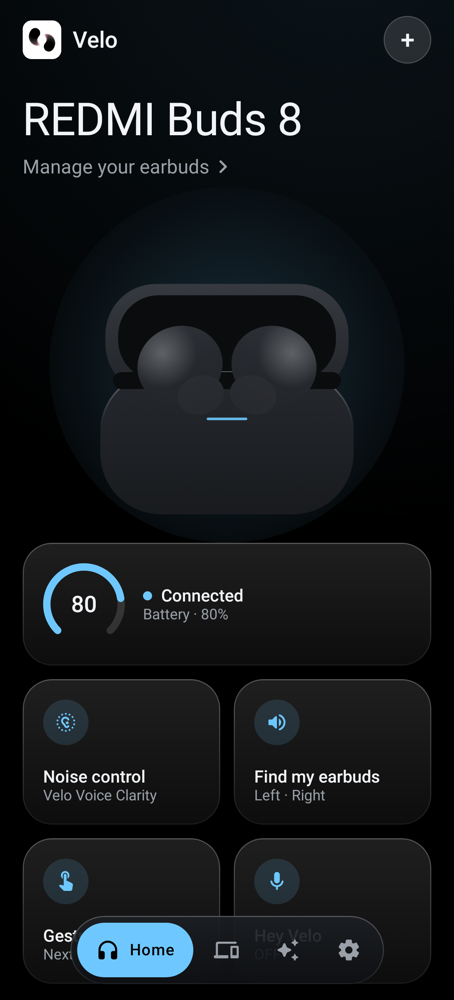
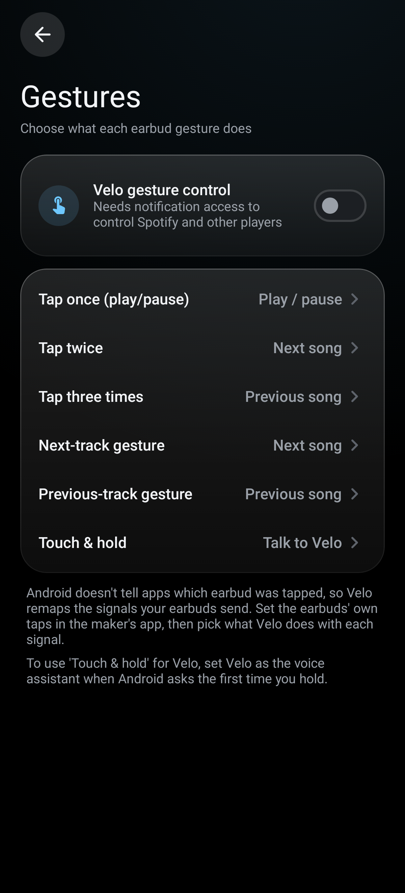
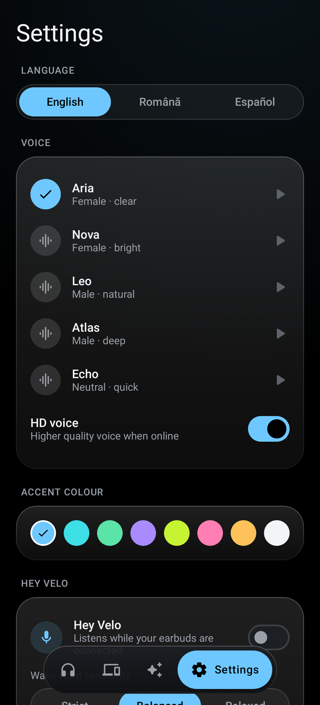
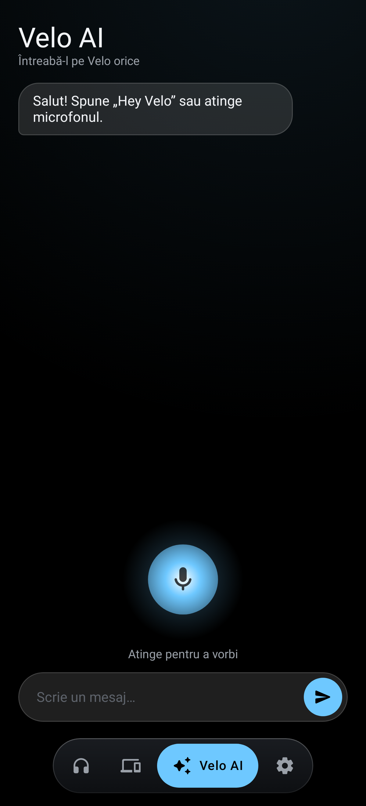

# Velo

An Android app for your earbuds with a built-in voice assistant ("Hey Velo").
Kotlin + Jetpack Compose. Black glass UI with a light-blue accent (the accent colour can be changed in Settings).

| Home | Gestures | Settings | Assistant (RO) |
|---|---|---|---|
|  |  |  |  |

## Features
- **Earbuds dashboard**: shows a picture of your model and its name, whether it's connected, and its battery level.
- **Saved earbuds**: one-tap connect to earbuds you've used before. **Find nearest** scans around you and sorts what it finds by signal strength.
- **Find my earbuds**: plays a loud chirp in the left bud, the right bud, or both. Your volume is restored afterwards, and the sound stops by itself after 45 s.
- **Hey Velo**: an offline wake word that listens only while your earbuds are connected. A cheap check for speech runs all the time, and the recogniser only starts when someone is talking. Tolerates sloppy pronunciation, with Strict, Balanced and Relaxed sensitivity settings.
- **Assistant**: music, volume, opening apps, battery, time and "find my earbuds" all run on the phone. Any other question goes to Claude (you need your own API key, entered in Settings). Velo answers in the app's language.
- **Languages**: English, Română and Español. Both the app text and Velo's voice switch.
- **Voices**: Aria, Nova, Leo, Atlas and Echo. Velo picks the best installed text-to-speech voice of each gender, and HD voice uses Google's network voices when you're online.
- **Gestures**: choose what 1, 2 or 3 taps, the next/previous gestures and touch-and-hold do: play/pause, next, previous, louder, quieter, Talk to Velo, find earbuds, or open any app (Spotify and so on).

## Build
`./gradlew assembleRelease` → `app/build/outputs/apk/release/app-release.apk`. GitHub Actions ("Velo APK") also builds it on every push.
UI screenshots: `./gradlew recordRoborazziDebug`.
